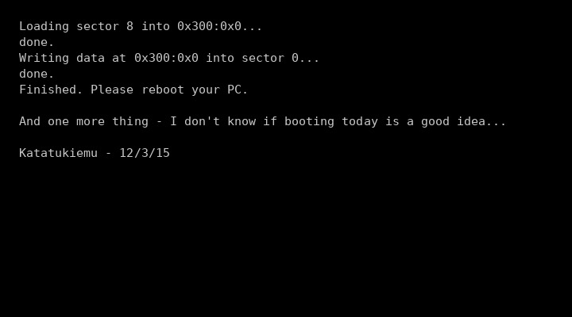

# Mist bootkit 驱动逆向笔记

对 `mistdrv.sys`（"Mist Kernel Driver"）的静态逆向结果。**样本来自沙箱 VM，未执行分析**，
所有结论均来自 PE 结构、反汇编与数据段解密。

@source 样本来源见文末「Source」一节（文件哈希 + 提取方式 + 安装器信息）。

---

## 概述

| 项目 | 值 |
|---|---|
| 文件名 | `mistdrv.sys` |
| 大小 | 14,552 字节 |
| 类型 | PE32 native（**i386 内核驱动**，minifilter） |
| 导入 | `FLTMGR.SYS`、`ntoskrnl.exe`、`HAL.dll` |
| PE 编译时间戳 | 2016-01-04 14:50:57 UTC |
| 数字签名 | **自签名** `CN=Mistejk`；时间戳 2015-08-21 16:33:03 UTC（Symantec 免费时间戳服务） |
| MD5 | `fb021609c5635e3afd5d65384f83a77e` |
| SHA256 | `40fd2d7e99c37b89bf8145000ed30479aa6d0a7c82d28eebb00d2377d0ac9f17` |

安装器（`MistInstaller.exe` / `MistInstallerRC.exe`，8,504 / 85,504 字节）创建服务：

```
服务名      Mist Kernel Driver  (注册表键 mistdrv)
ImagePath   system32\drivers\mistdrv.sys
Start       0  (BOOT_START)
Type        2  (内核驱动)
```

> 32 位安装器写 `system32\drivers` 时被 WOW64 重定向到 `SysWOW64\Drivers`，
> 且 32 位驱动无法在 64 位内核加载，因此在 x64 系统上从未生效。

---

## 结构

```
DriverEntry (0x401000)
 ├─ 日期判定 → 模式变量 [0x403a0c] = 0..4
 ├─ FltRegisterFilter(0x403640) / FltStartFiltering
 ├─ 模式 2：KeInitializeDpc(0x403a60, routine=0x401c00)，KeSetTimerEx(period=100ms)
 └─ 模式 4：MBR 覆盖 → 播放曲调 → KeBugCheckEx(0xDEADDEAD)

FLT_REGISTRATION @0x403640
 ├─ FilterUnload         0x401920
 ├─ InstanceSetup        0x401960  (return 0)
 └─ OperationRegistration @0x4020a0
     ├─ IRP_MJ_CREATE           Pre = 0x401970   (拦截打开)
     ├─ IRP_MJ_SET_INFORMATION  Pre = 0x4019f0   (拦截删除)
     └─ IRP_MJ_WRITE            Post = 0x401a80  (覆盖写入内容)
```

---

## 日期触发（核心）

DriverEntry 调用 `KeQuerySystemTime` + `RtlTimeToTimeFields`，按 **(月, 日)** 选择模式：

| 月/日 | 模式 | 行为 |
|---|---|---|
| 其他任意日期 | 0 | 每次打开文件有 1/60 概率拦截（`RtlRandomEx % 60 == 45`） |
| **4/18** | 3 | 写入时把缓冲区逐字节替换为 `RtlRandomEx` 随机值（`*.BMP` 从偏移 54 开始，保留文件头） |
| **5/18** | 1 | 100% 拦截打开，返回 `0xC0000102` |
| **9/30** | 4 | 备份 MBR 到扇区 8 → 解密载荷写入扇区 0 → 播放曲调 → `KeBugCheckEx(0xDEADDEAD)` |
| **12/15** | 2 | 每 100 ms 泄漏 `0x40860`（264 KB）内存（约 2.6 MB/s） |

模式在 **驱动加载时（开机）** 决定，当天不再变化。

### 文件类型表

- 拦截打开（31 项，`0x4033e8`）：`*.TXT *.DOC *.DOCX *.PPT *.PPTX *.HTM *.HTML *.VBS *.XLS *.JS *.RTF *.CSS *.ASM *.C *.CPP *.PAS *.XLSX *.MP3 *.PDF *.KEY *.BMP *.JFIF *.JPEG *.JPE *.JPG *.PNG *.DIB *.ZIP *.TIF *.TIFF *.GIF`
- 覆盖内容（14 项，`0x403580`）：`*.TXT *.RTF *.VBS *.VBA *.CPP *.C *.ASM *.PAS *.KEY *.HTM *.HTML *.JS *.BMP`

---

## MBR 载荷

- 密文：`0x403018` 起 512 字节（文件偏移 `0x1618`）
- 密钥：`0x403218` 起 75 字节（文件偏移 `0x1818`）
- 解密：`0x401e00`，`out[i] = data[i] ^ key[i % 75]`
- 写入：`\Device\Harddisk0\DR0` 偏移 0（原 MBR 先备份到偏移 `0x1000` = 扇区 8）
- 明文 SHA256：`159fa88a4c9d6e569c01405ab32350a5b2d1f1ab413d773bb3b122a945d1b240`
- 结构：16 位引导代码，末尾 `55 AA`


### 引导代码反汇编

```
0x7F  设 DS=0x7C0 / FS=0xB800 / GS=0xA000 / SS=0 / SP=0x1000
0x97  int 10h AX=0x0013        切到 VGA 模式 13h（320x200x256）
0x9F  绘图循环
        CX: 0..0x140(320)   DX: 0..0xC8(200)
        AL 逐像素递增（颜色循环），call 0x6E 写显存 A000:xxxx
0xBD  int 16h AH=0x01          检测按键（每条扫描线都查一次）
        无按键 → 0x123（继续画下一轮）
        按键 == 'r'(0x72) → 继续
0xCA  int 10h AX=0x0003        切回文本模式 80x25
0xD0  打印 "Loading sector 8 into 0x300:0x0... "
0xD8  int 13h AH=0x02          读扇区 9（CHS，即 LBA 8）→ 0x300:0x0
0xED  打印 "done." / "Writing data at 0x300:0x0 into sector 0... "
0xFD  int 13h AH=0x03          把 0x300:0x0 写回扇区 1（LBA 0 = MBR）
0x111 打印 "done." / "Finished..." / "And one more thing..."
0x121 cli; hlt                 停机
```

### 关键结论：按 R 可以还原

驱动在覆盖前把**原 MBR 备份到了扇区 8**；引导代码在检测到用户按下 **`r`** 后，
会把扇区 8 读回并写回扇区 0 —— **等于把机器修好**。

所以这不是不可逆的"炸机"，而是一个**可修复的恶作剧式 bootkit**：
开机先看一段 320x200 的彩色动画，等不到 `r` 就一直画；按下 `r` 才恢复并打印那段文字。



### 解密后的启动画面文本

```
Loading sector 8 into 0x300:0x0...
Writing data at 0x300:0x0 into sector 0...
Finished. Please reboot your PC.

And one more thing - I don't know if booting today is a good idea...
done.
Katatukiemu - 12/3/15
```

对应偏移：`0x128`、`0x14c`、`0x178`、`0x1e1`、`0x1e9`。

---

## 蓝屏前播放的曲调

`0x401c70` 是一个 PC 喇叭播放器：直接写端口 `0x42`（PIT 通道 2）与 `0x61`（扬声器门控），
`KeDelayExecutionThread` 控制时长（参数 × 10000 个 100ns 单位 = 毫秒）。

- 共 51 个音符，A 大调，总时长约 23 秒（含间隔）
- 音高序列：
  `E7 D7 B6 C#7 | C#7 B6 A6 | A6 B6 C#7 E7 F#7 G#7 | F#7 E6 F#6 | D7 C#7 D7 E7 F#7 A7 | F#7 A7 C#8 | C#8 A7 E7 | C#7 B6 A6 B6 C#7 | C#7 C#7 D7 E7 F#7 A7 | F#7 A7 C#8 | C#8 A7 E7 | C#7 B6 A6 B6 C#7 | C#7`
- 频点：2711 / 2415 / 2280 / 2031 / 1809 / 1708 / 3043 / 3416 / 1355 / 1521 Hz 等
- 音频文件：`docs/media/mist_tune.mp4`（波形可视化 + 原声）

---

## 复现解密

```bash
python3 - <<'PY'
d = open('mistdrv.sys','rb').read()
pay = d[0x1618:0x1618+512]
key = d[0x1818:0x1818+75]
out = bytes(b ^ key[i % 75] for i, b in enumerate(pay))
print(out[0x128:0x1F4].decode('latin-1'))
PY
```

---

## 结论与局限

- 这是一个**按日期触发的内核级破坏程序**：改 MBR、破坏文件、泄漏内存、拦截文件访问
- 作者标记 `Katatukiemu - 12/3/15`；证书 `CN=Mistejk` 为自签名，无任何厂商背书
- 上述结论全部来自静态分析；**没有在分析机上执行样本**，也没有观察到运行时行为
- 公网检索（Triage、Trend Micro、MITRE 等）未发现该样本或作者的公开记录

---

## Source

| 项目 | 值 |
|---|---|
| 提取自 | 沙箱 VM `win11-malware` 磁盘 `C:\Windows\SysWOW64\Drivers\mistdrv.sys` |
| 安装器 | `MistInstaller.exe` MD5 `8813125a606768fdf8df506029daa16f`；`MistInstallerRC.exe` MD5 `d81acaef0db08aac297d4bd3c58ddf50`（两者仅差 2 字节） |
| 驱动 | `mistdrv.sys` MD5 `fb021609c5635e3afd5d65384f83a77e` / SHA256 `40fd2d7e99c37b89bf8145000ed30479aa6d0a7c82d28eebb00d2377d0ac9f17` |
| MBR 载荷 | SHA256 `159fa88a4c9d6e569c01405ab32350a5b2d1f1ab413d773bb3b122a945d1b240`（解密后） |
| 服务键 | `HKLM\SYSTEM\ControlSet001\Services\mistdrv` |
| 分析工具 | radare2（反汇编）、objdump、python pefile、openssl（证书）、ffmpeg（音频合成） |
| 分析日期 | 2026-11-06 |
